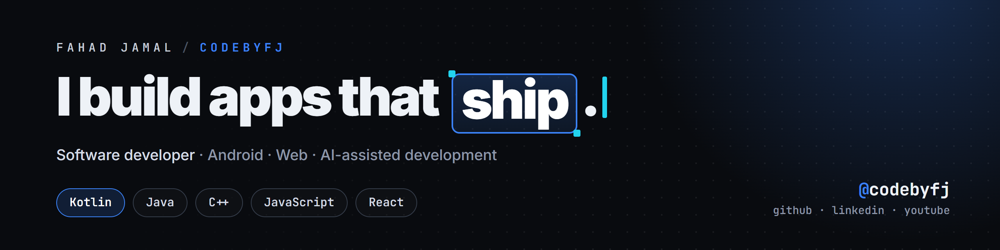
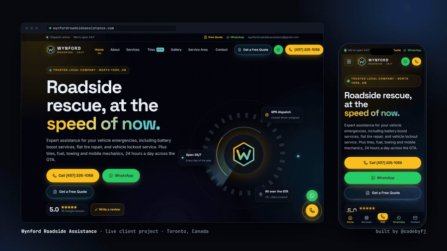

## Fahad Jamal
**Software developer · Android & Web · Code by FJ**

BSIT student (5th semester) at the University of Sargodha, Pakistan.
I build Android apps with Kotlin and Java, websites with React and Node.js, and small automation tools. I use AI coding tools and agent workflows daily, and I review and test what they produce before it ships.

### Featured project: Wynford Roadside Assistance

Website for a 24/7 towing and roadside company in Toronto. The brief: a stranded driver reaches them in one tap, and the owner runs the site without a developer.

- Call / WhatsApp on every screen and a 3-step quote form
- Live Google reviews from the Places API
- Real job gallery and a GTA service area map
- Admin panel: SEO editor, lead inbox, one-click publish

`React` `Vite` `Node.js` `PostgreSQL` `Vercel` · [Live site](https://www.wynfordroadsideassistance.com) · code is private (client project)

New projects get added here when they're done.

### Tools I use

  

### Learning now
- Jetpack Compose
- Building agent-based tools with LLM APIs

### Contact
[LinkedIn](https://www.linkedin.com/in/codebyfj) · [codebyfj.com](https://codebyfj.com) · [YouTube](https://www.youtube.com/@codebyfj) · [Instagram](https://www.instagram.com/codebyfj) · [TikTok](https://www.tiktok.com/@codebyfj)
